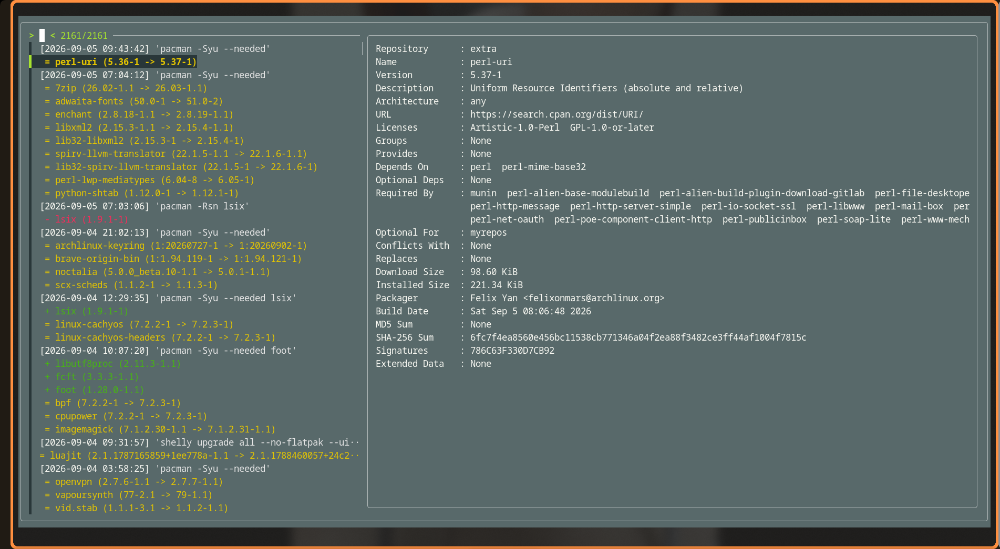

# Package History Navigator

`phn` is a small CLI tool for Arch Linux that organizes package operation history and lets you browse it interactively. It combines entries from `/var/log/pacman.log` and `/var/log/shelly.log`, shows installations, removals, and upgrades, and displays package details from `pacman -Sii` when a package is selected.



## Requirements

- Arch Linux with `pacman`
- Bash
- `awk`, `sed`, `perl`
- [`fzf`](https://github.com/junegunn/fzf) for interactive selection (a recent version is required, since the script uses `--ghost` and the `transform` / `change-ghost` actions)
- `wl-clipboard` (`wl-copy`) or `xsel` for copying the selected entry
- optionally, `shelly` if the history should also include operations recorded by Shelly

The script needs access to the relevant log files. If access to `/var/log` is restricted, run it with permissions that allow the logs to be read.

## Installation

```bash
git clone https://github.com/mtriam/package-history-navigator.git
cd package-history-navigator
install -Dm755 phn ~/.local/bin/phn
```

Make sure `~/.local/bin` is included in your `PATH`.

Alternatively, install the script directly with `wget`:

```bash
mkdir -p ~/.local/bin
wget -O ~/.local/bin/phn https://raw.githubusercontent.com/mtriam/package-history-navigator/main/phn
chmod +x ~/.local/bin/phn
```

## Usage

Running the command without arguments opens an interactive view of all operations, with the newest command blocks first:

```bash
phn
```

In interactive mode, select an entry in `fzf`. The preview panel on the right shows package information (`pacman -Sii`) for package entries, or the full command for command entries.

The selection is copied to the clipboard using `wl-copy` when available, or `xsel` as a fallback:

- selecting a package entry (`+`, `-`, `=`) copies the package name,
- selecting a command entry copies the command itself.

If neither clipboard tool is installed, the selection is not copied.

### Searching

By default, typing a query jumps to the first matching line while the whole list stays visible. The available keys are:

| Key | Action |
| --- | --- |
| `Ctrl+N` | Jump to the next match (or move down when the query is empty) |
| `Ctrl+P` | Jump to the previous match (or move up when the query is empty) |
| `Ctrl+R` | Toggle restricting the list to matching lines (`restrict:ON` / `restrict:OFF`, shown in the hint line) |

### Modes

| Command | Description |
| --- | --- |
| `phn` | All operations in interactive mode |
| `phn c` / `phn change` | Changes only: installations and removals |
| `phn u` / `phn update` | Upgrades only |
| `phn d` / `phn dump` | Raw data dump instead of the interactive view |

### Modifiers

Modifiers can be combined, either as one argument (`phn unm`) or as separate words (`phn update number monochrome`):

| Modifier | Description |
| --- | --- |
| `n` / `number` | Add line numbers |
| `m` / `monochrome` | Disable colors |
| `f` / `first` | Remove duplicates, keep the first occurrence |
| `l` / `last` | Remove duplicates, keep the last occurrence |
| `i` / `installed` | Show only packages that are currently installed |

Notes on the filters:

- **Duplicates** (`f`, `l`) are detected by the combination of operation and package name. For example, with `l`, only the most recent upgrade of a given package is kept, but its installation and upgrade entries remain separate. `f` and `l` are mutually exclusive: if both are given, the last one specified wins.
- **Installed** (`i`) compares entries against `pacman -Qq`. A `+`, `-`, or `=` entry is kept if the package is currently installed, regardless of the operation. Entries for packages that are no longer installed are hidden.
- In interactive mode, command blocks left with no entries after filtering are not shown.

Examples:

```bash
phn c       # installations and removals
phn change  # same as phn c
phn un      # upgrades with line numbers
phn update  # same as phn u
phn du      # upgrades as a raw data dump
phn dump update # raw upgrades dump
phn unm     # upgrades, line numbers, no colors
phn update number monochrome # full modifier names
phn f       # all operations, duplicates removed (first occurrence kept)
phn l       # all operations, duplicates removed (last occurrence kept)
phn i       # only packages that are currently installed
phn fi      # first occurrences, only currently installed packages
phn li      # last occurrences, only currently installed packages
phn dfi     # dump: first occurrences, only currently installed packages
phn dli     # dump: last occurrences, only currently installed packages
phn dim     # dump: only currently installed packages, no colors
phn --help
phn --version
```

## How It Works

1. Reads relevant entries from the `pacman` and `shelly` logs.
2. Normalizes dates, operation types, and version numbers.
3. Sorts events chronologically and groups them by the command that was run.
4. Applies the optional filters: removal of duplicates (`f` / `l`) and restriction to currently installed packages (`i`).
5. Displays the history in `fzf` in interactive mode, while the preview retrieves package information with `pacman -Sii`.

## License

The project is available under the terms described in [LICENSE](LICENSE).
